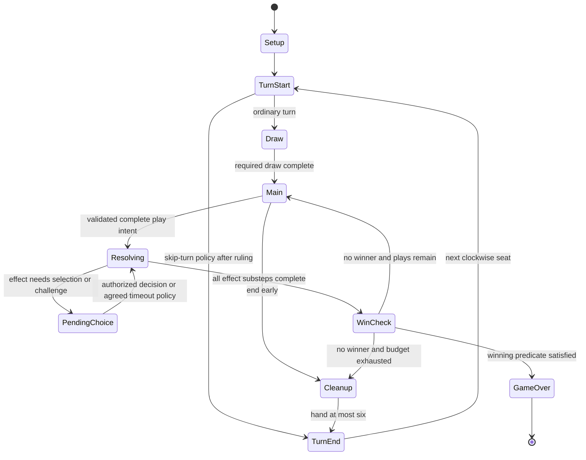

# Finite state machine specification

**PROPOSED DIGITAL UX / ENGINE DESIGN** grounded in the [rule ledger](../sources.md). No executable reducer is supplied.



Room pause is a lifecycle wrapper around any phase, preserving the underlying phase and pending-choice state. A network disconnect does not transition the game to TurnEnd. Invalid requests leave both phase and card zones unchanged.

| State | Accepted gameplay input | Authorized actor | Exit condition / mutation |
|---|---|---|---|
| Setup | None | Server | Approved profile, seats, distribution, private shuffle |
| TurnStart | None | Server | Restrictions evaluated once per turn ID |
| Draw | None normally | Server | Two draws or verified replacement; recycle is internal |
| Main | PlayCard, EndTurn; permitted gift/discard policy | Active player for plays; transfer owners for gifts | Budget decrement only on valid play |
| Resolving | No new ordinary action | Server | Instant effect or PendingChoice |
| PendingChoice | ResolveChoice / accepted timer submissions | Specific player named by effect | Choice ID and current hand constraints valid |
| WinCheck | None | Server | Terminal outcome or next phase |
| Cleanup | DiscardExcess | Active player | Exactly enough distinct owned hand cards to reach six |
| TurnEnd | None | Server | Restriction expiry and next seat once |
| GameOver | Rematch readiness only at room layer | Eligible room members | Original match stays immutable |

## Pending effect shape

```text
PendingEffect
  id, kind, sourcePlayerId, targetPlayerId, sourceCardInstanceId
  targetDisorderInstanceId, authorizedChooserId
  relevantHandRevision, allowedChoiceCount, optionalChoice
  createdAt, deadlineAt? [server time; only approved timer policy]
  visibilityGrant? [Anxiety attacker only]
  resolutionStage, policyVersion
```

For Anxiety, victim's identities become temporarily visible to the inflictor; the inflictor chooses one or declines. For Gambling, server randomness is proposed rather than asking the attacker to name known card identities. For Tremors, victim is the chooser and deadline semantics require U05. These are distinct effect kinds and must not share an incorrect generic target UI.

## Restriction representation

Store cause event, recipient, affected phase, and expiry boundary. Use explicit policy version rather than an unverified `duration:1` field. Expiry, repeated applications, source removal, skip/draw overlap, and gifts during restricted turns remain gates U02–U04/U08.

Selection is not a server phase for ordinary cards. The actor submits a complete card+target command; server does not trust client-highlighted legality. A frozen PendingChoice remains a server phase across reconnect.
